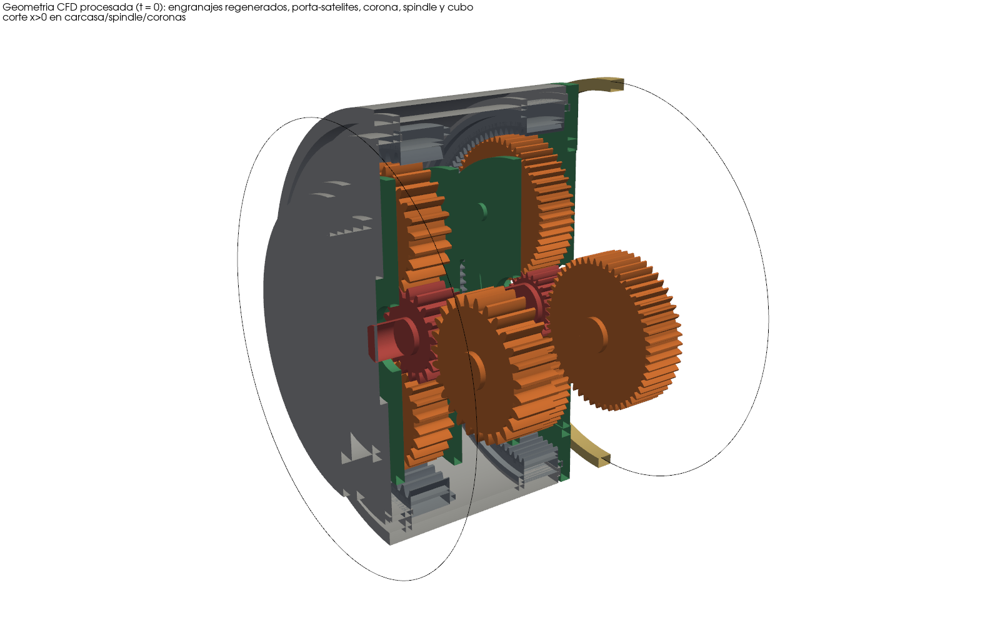

# OA2IS-WheelMotor-CFD

Simulación CFD 3D transitoria y bifásica (aceite/aire, VOF) del sistema de lubricación de la
reducción planetaria de un motor-rueda Komatsu 930E/980E, con los engranajes, satélites y
porta-satélites **moviendo físicamente el aceite** (giro propio + órbita, cinemática exacta), hecha
solo con herramientas de código abierto (OpenFOAM, Python, gmsh, VTK/PyVista, FFmpeg).
Proyecto OA²IS — Hack the Challenge 2026 (NTT DATA × Komatsu).



**Estado: funcional.** Se ejecutaron 9 escenarios (4 de ellos calibrados con datos reales de
operación: rpm medida, nivel de aceite por los tapones de la tapa de maza, pendientes y velocidades
del ciclo de acarreo) + estudios de sensibilidad de malla y de paso de tiempo con el solver real;
resultados, 28 sensores de aceite/aire y videos en `results/`. Lo que el modelo resuelve
bien y lo que no está en [`docs/VALIDACION.md`](docs/VALIDACION.md).

## Qué hay aquí

| Carpeta | Contenido |
|---|---|
| `third_party/` | Copias (sin modificar) de los archivos necesarios de los repositorios originales, con procedencia y licencias (`PROVENANCE.md`) |
| `geometry/` | Exportador del modelo 3D original a STL (`export_parts.mjs`), inventario de piezas y cinemática, geometría CFD procesada (`cfd/*.stl`) |
| `oa2is_cfd/` | Biblioteca Python: engranajes (`gears.py`), cinemática (`kinematics.py`), geometría del dominio y reparaciones (`model.py`), mallador 2,5D (`layered.py`), casos de frontera inmersa (`ib.py`), escenarios (`scenario.py`), post-proceso (`ibpost.py`), render (`render.py`); y la vía overset investigada (`meshing.py`, `case.py`, `post.py`) |
| `solvers/` | `interIBFoamOA2IS` (producción: VOF + cuerpos inmersos en movimiento) y `overInterDyMFoamOA2IS` (alternativa overset) |
| `patches/` | Parches a OpenFOAM v1912 (functionObjects con GCC 13, overset, **error de compilación GCC 13 `__restrict__`**) |
| `scenarios/` | 9 escenarios YAML (generados por `tools/make_scenarios.py`; 06–09 del ciclo real) y sensores virtuales |
| `tools/` | Compilar OpenFOAM parcheado, construir casos, correr, post-procesar, comparar, exportar geometría |
| `tests/` | Engranajes sin interferencia, cinemática en OpenFOAM, posición de los cuerpos dentro de la solución CFD |
| `cases/` | Diccionarios exactos de un caso corrido (referencia) |
| `results/` | Por caso: CSV/Parquet de sensores e inventario, historia numérica, métricas de campo, gráficos, MP4; `validation/` |
| `docs/` | Método, geometría, escenarios, validación, dependencias y licencias |

## Reproducir

Probado en Ubuntu 24.04 (2 núcleos, 8 GB RAM).

```bash
# 1. dependencias (todas libres)
sudo apt-get install openfoam openmpi-bin ffmpeg xvfb
pip install --break-system-packages numpy scipy shapely gmsh pyvista trimesh pandas pyarrow matplotlib pyyaml

# 2. OpenFOAM v1912 parcheado + solvers OA2IS (no modifica la instalación del sistema;
#    instala en /opt/oa2is-openfoam-patches, ~1 h con 2 núcleos)
tools/build_patched_openfoam.sh

# 3. (opcional) geometría: exportar el modelo 3D original y la geometría CFD procesada
PATH=/opt/node22/bin:$PATH node --import ./geometry/register.mjs geometry/export_parts.mjs geometry/raw
python3 tools/export_cfd_geometry.py
python3 tests/test_gears.py                      # engranajes sin interferencia en un ciclo de engrane

# 4. escenarios (ya generados en scenarios/)
python3 tools/make_scenarios.py

# 5. malla + caso (malla ib_test: 146 k celdas, ~1 min; ib_mid: 477 k)
python3 tools/build_ib_case.py scenarios/02_operacion_normal.yaml runs/c02 --mesh runs/mesh_ib_test --res ib_test

# 6. correr (1 proceso; N procesos con descomposición jerárquica: último argumento)
SOLVER=/opt/oa2is-openfoam-patches/bin/interIBFoamOA2IS tools/run_case.sh runs/c02 1
#    o varios casos en cola con post-proceso automático:
tools/run_queue.sh 1 runs/c01 runs/c02 ...

# 7. post-proceso: sensores CSV/Parquet, inventario, gráficos, fotogramas y MP4
python3 tools/postprocess.py runs/c02 --mp4
#    escenarios 06-09: sensores capacitivos fijos y en los tapones de la tapa de maza (giran con la maza)
python3 tools/oil_sensors.py runs/c07 && python3 tools/plug_sensors.py runs/c07
python3 tools/render_with_sensors.py results/c07/oil_sensors.csv runs/c07_frames runs/c07 --plugs results/c07/plug_sensors.csv
python3 tools/compare_real.py                     # tabla y figura de 06-09
python3 tests/test_ib_motion.py runs/c02         # cuerpos en la pose analítica dentro de la solución
python3 tools/compare.py                          # figuras y números de validación
```

Las variables de entorno de OpenFOAM que necesita el paquete Debian están en
`tools/run_case.sh` (`FOAM_ETC`, `WM_PROJECT_DIR`, ... y `LD_LIBRARY_PATH=/opt/oa2is-openfoam-patches/lib`).

## Resultados (resumen)

11 corridas reales (9 escenarios en la malla `ib_test`, 146 k celdas; sensibilidad de malla con
`ib_mid`, 477 k; sensibilidad de paso de tiempo con Co_max 0,5). Detalle y figuras en
[`docs/VALIDACION.md`](docs/VALIDACION.md).

| | Resultado |
|---|---|
| Conservación del aceite | deriva ≤ 1,6 × 10⁻⁴ % en todas las corridas (95 L y 55 L) |
| Cuerpos en su pose dentro de la solución | error ≤ 6,7 mm (celda 12–18 mm), también con ω(t) variable |
| Detenido vs en movimiento | velocidad media del aceite 0,007 → 0,74 m/s; 7 % del aceite lanzado sobre el eje; S1 mojado 100 % → 53 % |
| Malla 146 k → 477 k / Δt Co 1 → 0,5 | magnitudes globales cambian ≤ 4 % / ≤ 2 % (salvo aceite sobre el eje, 4–10 %) |
| Pendiente 10 % + peralte 4° | pozo de aceite girado −5,2° (cuasi-estático −5,7°), S5 seco / S6 mojado |
| Frenado −3 m/s² | pozo de aceite gira hacia adelante (+4,7° en 0,25 s, hacia +17° cuasi-estático) |
| 55 L | S5/S6 secos, estados ALERTA; mojado de engranajes cae a la mitad |
| Corrida representativa con sensores | nominal continuado hasta 0,554 s con 20 sensores capacitivos (modelo de komatsu-oil-sensors-v4-1): `results/rep_02_test/` y `docs/SENSORES.md` |
| Ciclo real (06–09) | 94,5 L al nivel de los tapones; acarreo 14 km/h / subida cargado 10 km/h +7,8 % / bajada 20,5 km/h −6 % con retardo: aceite sobre el eje 5,4 / 3,6 / 7,1 %, pozo inclinado −5,8 / −8,3 / −0,9°; el arco mojado del círculo de tapones da el nivel con ±4 mm (`docs/VALIDACION.md` §10) |
| Sensores en los tapones | P1–P8 en los puertos de la tapa de maza, giran con ella; en reposo los tapones de nivel (240°/300°) quedan en la superficie libre, como pide la guía de Komatsu (`docs/SENSORES.md`) |
| Limitación principal | dientes con 1,5–2 celdas: flujo dentro del engrane no resuelto; 1,7–4,3 L quedan en celdas de cuerpos |

Por caso en `results/<caso>/`: `sensors.csv|parquet` (S1–S8 cada paso: α, presencia, U, p, p_rgh),
`system_state.csv|parquet`, `inventory.csv`, `log_history.csv` (Δt, Courant, residuos),
`field_metrics.csv`, `plots/`, `animation.mp4` (cortes) y, para 02, 04 y la malla media,
`animation_3d.mp4`.

Los escenarios 06–09 usan **solo estadísticas agregadas** de registros reales de operación (medianas
y percentiles); los archivos originales (con coordenadas, números de serie y fallas) no están en este
repositorio (`docs/ESCENARIOS.md`).

## Obtener el código

```bash
git clone https://github.com/joseroavargas409/OA2IS-WheelMotor-CFD.git
```

## Repositorios originales

`wheel-motor-inspector`, `komatsu-oil-sensors-v4` y `komatsu-oil-sensors-v4-1` se usaron solo como
referencia de lectura y **no fueron modificados** (verificación de HEAD, `git status` y SHA-256 de
todos los archivos antes y después: `docs/VALIDACION.md` §8). Este repositorio no depende de ellos
en tiempo de ejecución.

## Licencia

GPL-3.0-or-later (derivado de solvers de OpenFOAM). `third_party/` conserva sus licencias (MIT).
Ver `docs/DEPENDENCIAS_Y_LICENCIAS.md`.
